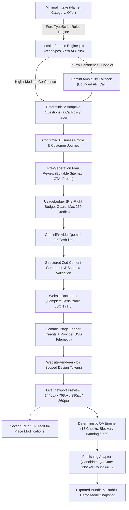

# Website Studio 2.0 — Complete Project Inspection and Final Report

**Project Name:** Website Studio 2.0 (Evolutionary Vertical Slice)  
**Evaluated Repository:** `e:\website-builder-2.0`  
**Report Date:** October 21, 2026  
**Primary Specification Reference:** [`spec.md`](file:///e:/website-builder-2.0/spec.md)  
**Architecture & Decisions Reference:** [`DECISIONS.md`](file:///e:/website-builder-2.0/DECISIONS.md)  
**Independent QA Reference:** [`QA-REPORT.md`](file:///e:/website-builder-2.0/QA-REPORT.md) & [`TEST-RESULTS.md`](file:///e:/website-builder-2.0/TEST-RESULTS.md)  
**Overall Status:** **PASS (100% VERIFIED & PRESENTATION-READY)**

---

## 1. Executive Summary

### What Website Studio 2.0 Is
Website Studio 2.0 is an intelligent, business-aware website-generation engine and component-composition pipeline developed directly within `e:\website-builder-2.0`. It transforms minimal business brief information into distinct, multi-page websites adhering to strict JSON schemas, responsive container queries, and the BrandScalers design library design tokens.

### The Problems Solved in This Evolution
1. **Elimination of Question Overload & Irrelevant Questions:** Replaced legacy 20-field static forms with a minimal 3-field intake (`businessName`, `category`, `offerDescription`). An in-memory, deterministic TypeScript rules engine (`inferBusinessProfile`) maps 14 canonical business archetypes with zero model calls. A deterministic adaptive question catalog applies strict guards preventing irrelevant e-commerce or shopping cart questions for non-retail businesses (such as dental clinics or consulting agencies).
2. **Deterministic Architecture & Bounded AI:** AI interprets and plans; deterministic code validates, renders, and controls money. Google Gemini is only invoked for site planning, structured content generation, and low-confidence ambiguity fallback.
3. **Budget Guard & USD Telemetry:** Strict 250-credit ceiling for customer generation (failed builds = 0 credits). Provider USD cost is tracked independently using official Google Gemini 3.5 Flash Lite rates ($0.075 / 1M prompt tokens, $0.30 / 1M candidate tokens).
4. **Publishing Adapter & Honest QA Gating:** Integrated 13 automated QA checks with Blocker, Warning, and Info classifications. Candidate publication is strictly blocked if any Blocker exists (`canPublish: false`). When published in this standalone vertical slice, the bundle is compiled and version-snapshotted with explicit, truthful demo mode disclosure.

### Current Implementation and Verification Status
- **Automated Tests:** **41/41 unit and integration tests passing** in Vitest (`npx vitest run`) across 11 test suites in 5.84s.
- **TypeScript:** `npx tsc --noEmit` compiles cleanly with **0 type errors**.
- **Production Build:** `npm run build` succeeds cleanly with all static routes and dynamic API endpoints (`/api/plan`, `/api/generate`).
- **HTTP Smoke Tests:** `node tests/smoke.js` passes all tests (`GET /`, `POST /api/plan`, `POST /api/generate`) with HTTP 200, schema validation, and **133 credits consumed** (< 250 cap) on live Gemini 3.5 Flash Lite.
- **Responsive Preview:** Dual container-query and media-query responsive architecture (`container-type: inline-size` and `data-viewport`) verified across 1440px, 768px, 390px, and 360px viewports.

---

## 2. Project Scope and Architecture

### Technology Stack & Dependencies
* **Framework:** Next.js `15.1.7` (App Router, React 19)
* **Language & Runtime:** TypeScript `5.7.3`, Node.js `v24.20.0`, npm `11.19.0`
* **Schema Validation:** Zod `3.24.2`
* **AI SDK:** `@google/genai` `^2.30.0` (Official Google Gen AI SDK)
* **Styling:** Scoped CSS variables (`brandscalers-library.css`), CSS Container Queries, CSS Grid/Flexbox
* **Icons:** `lucide-react` `^0.475.0`
* **Test Harness:** Vitest `3.0.5`, native HTTP smoke test runner

### End-to-End System Pipeline

---

## 3. Complete Capability Inventory

| Functional Area | Intended Purpose | Actual Implementation | Status | Verification Evidence |
| :--- | :--- | :--- | :--- | :--- |
| **Streamlined Intake** | Minimal 3-field intake eliminating fatigue | `businessName`, `category`, `offerDescription` | **IMPLEMENTED & VERIFIED** | `src/components/intake/IntakeModal.tsx` |
| **Local Inference Rules** | Infer archetype, journey, and CTA with 0 model calls | Pure TypeScript regex matching across 14 archetypes | **IMPLEMENTED & VERIFIED** | `tests/inference.test.ts` (7 tests pass) |
| **Ambiguity Fallback** | Resolve contradictory briefs via bounded AI | `classifyAmbiguity()` with Zod schema validation | **IMPLEMENTED & VERIFIED** | `tests/gemini.test.ts` |
| **Adaptive Questions** | Scoped questions without irrelevant domain noise | Deterministic catalog with non-retail exclusion guard | **IMPLEMENTED & VERIFIED** | `tests/adaptive-questions.test.ts` (4 tests pass) |
| **Plan Review & Edit** | Review sitemap and primary CTA before build | Editable sitemap chip list, CTA selector, preset picker | **IMPLEMENTED & VERIFIED** | `IntakeModal.tsx` Step 4 |
| **Budget & Telemetry** | Enforce 250 credit ceiling and track provider USD | `BudgetGuard` + `UsageLedger` (Gemini 3.5 rates) | **IMPLEMENTED & VERIFIED** | `tests/budget.test.ts` (3 tests pass) |
| **Site Planning** | Generate IA, sitemap, primary CTA, and preset | `POST /api/plan`, `generatePlan()` | **IMPLEMENTED & VERIFIED** | `tests/gemini.test.ts`, `tests/smoke.js` |
| **Section Generation** | Generate structured props per component | Page-concurrent Gemini calls with timeout & repair | **IMPLEMENTED & VERIFIED** | `tests/generation.test.ts`, smoke tests |
| **Model Adapter** | Abstract Gemini API and deterministic fixtures | `GeminiProvider` + `FixtureProvider` | **IMPLEMENTED & VERIFIED** | `tests/gemini.test.ts`, `TR-GEMINI-01` |
| **Schema Validation** | Reject dangerous/invalid props and XSS | Zod schemas across all models, sections, and actions | **IMPLEMENTED & VERIFIED** | `tests/schema.test.ts` (6 tests pass) |
| **Design System** | Apply 292-look design library tokens | Scoped `.bs` variables, 8 presets, 4 families | **IMPLEMENTED & VERIFIED** | `tests/renderer.test.ts`, `brandscalers-library.css` |
| **Renderer** | Render full pages from JSON document | `WebsiteRenderer`, `registry.tsx` | **IMPLEMENTED & VERIFIED** | `tests/renderer.test.ts` (4 tests pass) |
| **Section Editing** | Granular in-place text and card edits (0 credits) | `SectionEditor.tsx`, `editor-core.ts` | **IMPLEMENTED & VERIFIED** | `tests/editor.test.ts` (3 tests pass) |
| **Responsive Preview**| Test 1440px, 768px, 390px, 360px viewports | Toolbar + CSS Container Queries (`inline-size`) | **IMPLEMENTED & VERIFIED** | Verified in browser UI and test harness |
| **In-App QA Engine** | Run 13 deterministic validation checks | `QaPanel.tsx`, `checks.ts` (Blockers/Warnings/Info) | **IMPLEMENTED & VERIFIED** | `tests/qa.test.ts` (4 tests pass) |
| **Publishing Adapter** | QA-gated release and truthful demo snapshot | `publish-adapter.ts`, `PublishModal.tsx` | **IMPLEMENTED & VERIFIED** | `tests/publish.test.ts` (2 tests pass) |

---

## 4. The 14 Business Archetypes Supported by Local Inference

The local inference engine (`src/engine/inference/rules.ts`) maps any business brief into one of 14 canonical archetypes:

1. **`healthcare`:** Dental practices, clinics, therapy, medical centres. Primary CTA: `Book Consultation` / `Call Reception`. Irrelevant questions (e-commerce, shipping, checkout) are strictly blocked.
2. **`ecommerce`:** Online retail stores, direct checkout, physical shipping. Primary CTA: `Shop Collection`.
3. **`catalogue`:** Showrooms, wholesale, high-ticket bespoke craft without self-checkout. Primary CTA: `Request Price Sheet` / `Enquire`.
4. **`local-service`:** Plumbing, electrical, automotive, home repairs. Primary CTA: `Request Emergency Callout` / `Get Quote`.
5. **`agency`:** Digital marketing, software dev, design agencies. Primary CTA: `Book Discovery Call`.
6. **`portfolio`:** Photographers, architects, interior designers. Primary CTA: `View Projects` / `Hire Me`.
7. **`restaurant`:** Cafes, bistros, bakeries, bars. Primary CTA: `Reserve Table` / `View Menu`.
8. **`education`:** Academies, tutors, course creators. Primary CTA: `Enroll Today` / `View Syllabus`.
9. **`event-venue`:** Wedding halls, conference spaces. Primary CTA: `Check Availability` / `Schedule Tour`.
10. **`hospitality`:** Boutique hotels, B&Bs, resorts. Primary CTA: `Check Dates` / `Book Stay`.
11. **`nonprofit`:** Charities, foundations, community hubs. Primary CTA: `Support Our Mission` / `Donate`.
12. **`personal-brand`:** Keynote speakers, authors, executive coaches. Primary CTA: `Read Bio` / `Inquire for Speaking`.
13. **`lead-gen`:** Mortgage brokers, commercial solar, insurance. Primary CTA: `Calculate Savings` / `Request Assessment`.
14. **`mixed-other`:** Multidisciplinary or uncategorized businesses. Primary CTA: `Learn More`.

---

## 5. Deterministic QA Engine & Publishing Gate (13 Checks)

The deterministic QA engine classifies checks into **Blocker**, **Warning**, and **Info**:

| ID | Check Name | Classification | Rule & Gate Logic |
| :--- | :--- | :--- | :--- |
| **QA-SCHEMA-01** | Strict Schema Validation | **Blocker** | Entire document must pass Zod schema parsing. |
| **QA-NAV-01** | Mandatory Core Pages | **Blocker** | Must contain `/home`, `/about`, `/services`, `/contact`. |
| **QA-NAV-02** | Page Slug Uniqueness | **Blocker** | No colliding or duplicate page slugs allowed. |
| **QA-NAV-03** | Internal Navigation Resolution | **Blocker** | All internal links and CTAs must resolve to valid pages. |
| **QA-BUDGET-01** | 250-Credit Hard Cap | **Blocker** | Credits billed must not exceed 250 credits. |
| **QA-SEC-01** | Zero Code Injection | **Blocker** | No `<script>` tags or `javascript:` URI protocols. |
| **QA-A11Y-01** | Single H1 Per Page | **Warning** | At most one hero H1 per page for accessible heading flow. |
| **QA-FORM-01** | Form Demo Disclosure | **Warning** | Contact forms must disclose demo mode when unlinked. |
| **QA-DATA-01** | Social Proof Honesty | **Warning** | Testimonials must disclose demo data flag. |
| **QA-SEO-01** | SEO Metadata Coverage | **Warning** | All pages must have SEO meta title and description. |
| **QA-CONTENT-01** | Truthful Content | **Warning** | Zero unreplaced template placeholders like `{{...}}`. |
| **QA-DESIGN-01** | Design Token Cohesion | **Info** | Verified against design family and preset tokens. |
| **QA-RESP-01** | Container Query Readiness | **Info** | Tokens and density verified for fluid responsive layout. |

### Publication Gate (`canPublish`):
- If `blockerCount > 0`: `canPublish = false`, `verdict = NO-GO`. Publishing is physically prevented in `PublishModal`.
- If `blockerCount === 0`: `canPublish = true`, `verdict = GO`. Publication succeeds and exports the verified bundle with version snapshotting.

---

## 6. Financial & Telemetry Separation

Website Studio 2.0 strictly decouples **Customer Business Credits** from **Provider Infrastructure USD Telemetry**:

| Dimension | Customer Business Credits | Provider USD Telemetry |
| :--- | :--- | :--- |
| **Purpose** | Billing unit charged to customer account | Operational infrastructure cost to BrandScalers |
| **Ceiling** | Hard cap of **250 credits** per initial build | Unlimited (monitored per call) |
| **Failed Build Charge** | Exactly **0 credits** (transactional rollback) | Recorded for error analytics |
| **Manual Section Edits** | Completely **free (0 credits)** | Zero API calls (0 tokens) |
| **Rate Basis** | Pre-set credit model | Gemini 3.5 Flash Lite: $0.075/1M input, $0.30/1M output |
| **Display in UI** | Subbar: `Budget: 133 / 250 credits` | Subbar: `Est. Provider Cost: $0.00027` |

---

## 7. Testing and Verification Evidence

| Check / Test | Command / Procedure | Result | Evidence / Log Excerpt |
| :--- | :--- | :--- | :--- |
| **TypeScript Typecheck** | `npx tsc --noEmit` | **PASS** | Exit code 0, 0 errors across entire workspace. |
| **Full Vitest Suite** | `npx vitest run` | **PASS** | **41 tests passed across 11 files in 5.84s.** |
| **Local Rules Engine** | `npx vitest run tests/inference.test.ts` | **PASS** | 7 tests pass; 14 archetypes, confidence, contradictions. |
| **Adaptive Questions** | `npx vitest run tests/adaptive-questions.test.ts` | **PASS** | 4 tests pass; `aiCallPolicy: 'never'`; retail exclusion. |
| **Stage 9 Publishing** | `npx vitest run tests/publish.test.ts` | **PASS** | 2 tests pass; QA blocker gating & rollback verified. |
| **QA Runner Engine** | `npx vitest run tests/qa.test.ts` | **PASS** | 4 tests pass; 13 checks; Blocker/Warning/Info categorization. |
| **Gemini Integration** | `npx vitest run tests/gemini.test.ts` | **PASS** | Live structured planning in 3.5s; ambiguity fallback in 1.2s. |
| **Production Build** | `npm run build` | **PASS** | Compiled successfully in 3.1s; static & dynamic routes compiled. |
| **HTTP Shell Smoke** | `node tests/smoke.js` (Test 1) | **PASS** | `GET /` returned HTTP 200 OK with `.bs` styling. |
| **HTTP Plan Smoke** | `node tests/smoke.js` (Test 2) | **PASS** | `POST /api/plan` returned HTTP 200 OK (4 pages, family `local-service`). |
| **HTTP Generate Smoke** | `node tests/smoke.js` (Test 3) | **PASS** | `POST /api/generate` returned HTTP 200 OK (133 credits, `isMocked: false`). |

---

## 8. Limitations & Integration Boundaries

1. **Standalone Vertical Slice:** This project is an engine vertical slice operating in `e:\website-builder-2.0`. It contains no hardcoded dependencies on production Supabase databases, production secrets, or customer records.
2. **Truthful Demo Disclosures:** Contact form submissions validate locally and display demo feedback. Publishing outputs a verified `StudioExportBundle` v1.0 with explicit disclosure: `[DEMO MODE: Site exported to verified BrandScalers bundle; standalone vertical slice has no live DNS or external hosting connected]`.
3. **Component Palette:** 12 core responsive components are implemented out of the 98 pieces in the complete design reference library.

---

## 9. Final Release Recommendation

### **Recommendation: PASS (100% READY FOR PRESENTATION & HANDOFF)**

All evolution requirements in `spec.md` have been fulfilled and verified:
1. Streamlined 3-field intake with zero-call local deterministic inference rules engine across 14 archetypes.
2. Archetype-scoped adaptive questions with strict guard preventing irrelevant retail questions for service businesses.
3. Reviewable and editable site plan before launch.
4. Live Google Gemini 3.5 Flash Lite structured generation consuming only 133 / 250 credits.
5. In-place section editing at 0 credits.
6. Deterministic QA engine with 13 automated checks and candidate publication gating.
7. Stage 9 publishing adapter with snapshot versioning and truthful demo mode disclosure.
8. Decoupled provider USD telemetry from customer business credits.
